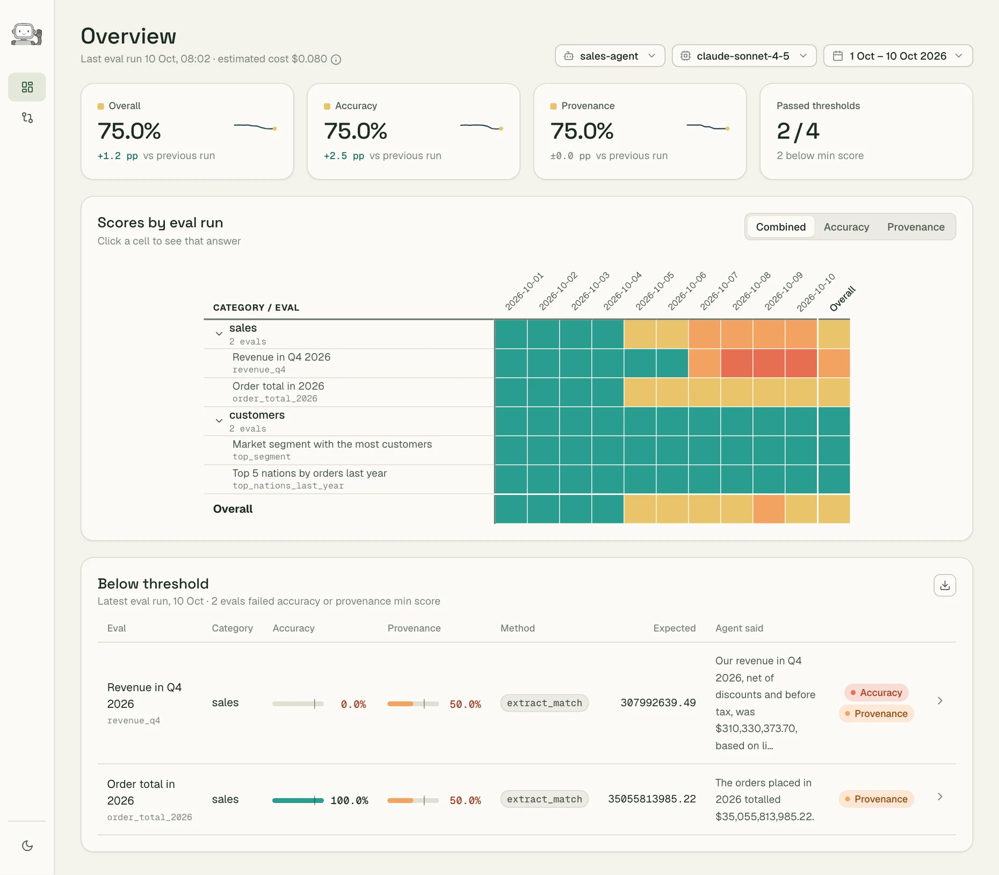

<p align="center"><a href="https://thehonestagent.dev"></a></p>

<p align="center">
  <a href="https://thehonestagent.dev/docs/">Docs</a> ·
  <a href="https://thehonestagent.dev/docs/getting-started/">Getting started</a> ·
  <a href="https://thehonestagent.dev/report/">Example report</a> ·
  <a href="CHANGELOG.md">Changelog</a>
</p>

# The Honest Agent (`honest-agent`)

Your analytics agent can give a confident answer from the wrong table.
`honest-agent` asks it questions you know the answers to, through the agent's own MCP
server, and checks each answer for two things:

- **accuracy**: is the answer right?
- **provenance**: did the agent's SQL read the tables it should?

> **Alpha (v0.2.0): expect breaking changes between versions.** Each release's notes in
> [CHANGELOG.md](CHANGELOG.md) say what changed and what to do.

<a href="https://thehonestagent.dev/report/"></a>

## What it does

- **Tests your real agent.** It runs Claude or GPT with the tools your agent's MCP server
  offers (Snowflake, MotherDuck or your own), not a copy of them.
  [Connect your agent](https://thehonestagent.dev/docs/connect/)
- **Grades every answer** against your thresholds, by matching text, extracting a number, or
  an LLM judge. [Writing evals](https://thehonestagent.dev/docs/writing-evals/)
- **Keeps every run** in a DuckDB file (local or in S3) or MotherDuck, with what each call sent and received.
  [Storing results](https://thehonestagent.dev/docs/storing-results/)
- **Builds a report** you can host for your team.
  [The report](https://thehonestagent.dev/docs/report/)
- **Alerts in Slack** when an eval falls below its threshold.
  [Setting up alerts](https://thehonestagent.dev/docs/alerts/)

## Quickstart

You need [uv](https://docs.astral.sh/uv/getting-started/installation/) and an Anthropic or
OpenAI API key. Try it on the bundled example, a demo agent over DuckDB's sample data:

```bash
mkdir my-agent-evals && cd my-agent-evals
uv init --bare --python 3.11
uv add "honest-agent @ git+https://github.com/jlcoto/the_honest_agent.git@v0.2.0#subdirectory=cli"
uv run honest-agent init --example
cd honest-agent-example          # then add your API key to .env
uv run honest-agent run
uv run honest-agent report
uv run honest-agent serve        # opens the report in your browser
```

To evaluate your own agent, follow
[Getting started](https://thehonestagent.dev/docs/getting-started/).

## Documentation

- [Getting started](https://thehonestagent.dev/docs/getting-started/): install and set up a project
- [Writing evals](https://thehonestagent.dev/docs/writing-evals/): what to test and how to grade it
- [Running it for a team](https://thehonestagent.dev/docs/team/): scheduled runs, a hosted report and alerts
- [CLI commands](https://thehonestagent.dev/docs/reference/cli/) and [config keys](https://thehonestagent.dev/docs/reference/config/)
- [Troubleshooting](https://thehonestagent.dev/docs/troubleshooting/)

## Repository

- [`cli/`](cli/): the `honest-agent` Python CLI
- [`ui/`](ui/): the source of the web report
- [`site/`](site/): the landing page and these docs
- [`example_project/`](example_project/): a demo project used for development

## Contributing

Bug reports and pull requests are welcome. [CONTRIBUTING.md](CONTRIBUTING.md) covers the
dev setup, tests and docs; [SECURITY.md](SECURITY.md) how to report a vulnerability.

## License

[MIT](LICENSE)
